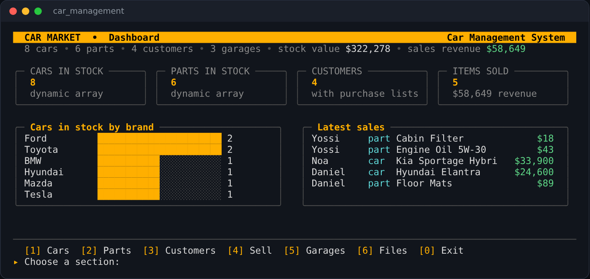
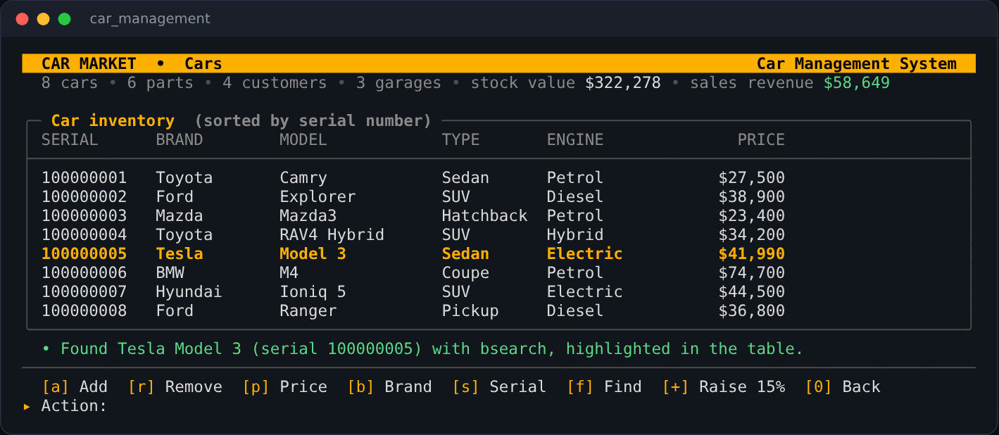
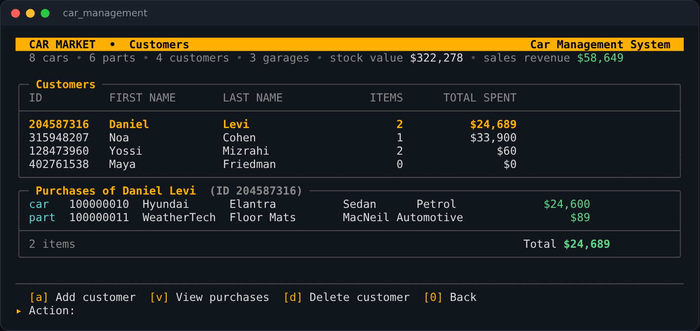
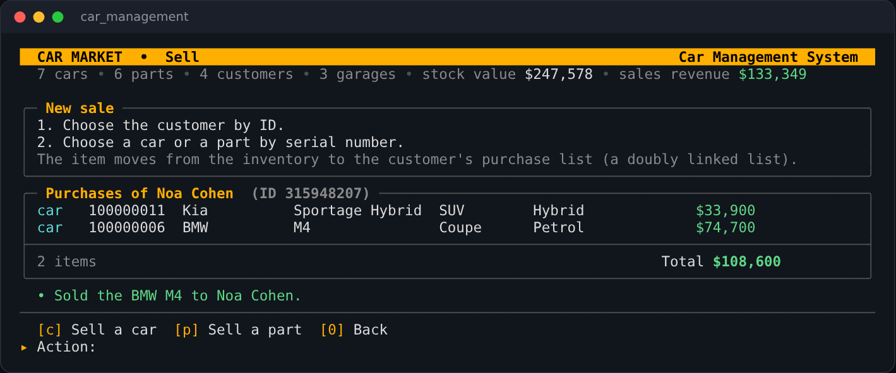
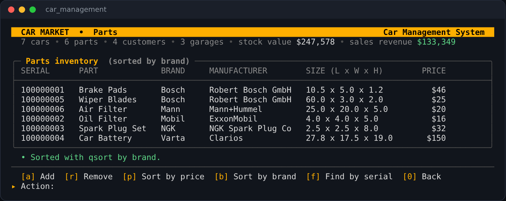

# Car Management System (C Project)

A car dealership manager written in **C**, built around manual memory management, linked lists, dynamic arrays, function pointers and file persistence. Developed as a university project for a C programming course, and later extended with a **full-screen terminal dashboard**.



---

## About

The system runs a small dealership: an inventory of cars and spare parts, a list of customers with their purchase history, and a list of partner garages. You can add and remove items, sort and search the inventory, sell cars and parts to customers, raise all car prices, and save or load everything in text or binary format.

The project has two front ends over the same store manager:

- **Dashboard** (default): a full-screen terminal UI with colours, tables, a stock chart and a live summary of the store.
- **Classic menu** (`--classic`): the original numbered text menu.

---

## C Concepts

| Concept | Where it appears |
|---|---|
| **Dynamic arrays** | Car and part inventories are arrays of pointers that grow and shrink with `realloc` |
| **Doubly linked list** | Each customer's purchases, holding both cars and parts |
| **Singly linked list** | Partner garages |
| **Function pointers** | `qsort` and `bsearch` with comparators for price, brand and serial number, and a `genericFunction` that applies a callback to every item in an array |
| **Dynamic strings** | A part's manufacturer is allocated to its exact length |
| **Structs and modular design** | Each entity has its own `.c` / `.h` pair, coordinated by a central `StoreManager` |
| **Text and binary files** | A readable CSV-like format, and a binary format that writes the structs directly and stores each manufacturer string with its length |
| **Macros and constants** | Field sizes, the price increase percentage and error printing live in `constants.h` |

---

## The Terminal Dashboard

Written in plain C with ANSI escape codes and UTF-8 box drawing, with no external libraries. It works on Linux, macOS and Windows 10 or later (it switches the Windows console to UTF-8 and enables escape codes automatically).

- **Home:** stock count, customers, items sold and revenue, a bar chart of cars in stock by brand, and the latest sales.
- **Cars:** inventory table, add, remove, sort with `qsort`, find with `bsearch` (the match is highlighted), and raise every price by 15%.
- **Parts:** inventory with sizes and manufacturers, sort and find by serial number.
- **Customers:** total items and amount spent per customer, and a detailed view of each purchase list.
- **Sell:** move a car or part from the inventory into a customer's purchase list.
- **Garages** and **Files:** manage partner garages, and save or load in either format.

Every input is validated (customer IDs must be 9 digits, prices must be positive, and text fields cannot contain the comma used by the file format).

<table>
  <tr>
    <td></td>
    <td></td>
  </tr>
  <tr>
    <td align="center"><sub><b>Car inventory: a bsearch result highlighted</b></sub></td>
    <td align="center"><sub><b>Customers and a purchase list (doubly linked list)</b></sub></td>
  </tr>
  <tr>
    <td></td>
    <td></td>
  </tr>
  <tr>
    <td align="center"><sub><b>Selling a car moves it into the customer's list</b></sub></td>
    <td align="center"><sub><b>Parts inventory sorted with qsort</b></sub></td>
  </tr>
</table>

---

## Project Structure

```
car.c / car.h                         # Cars, the car inventory, comparators, generic function
part.c / part.h                       # Parts, the part inventory, deep copy and free
customer.c / customer.h               # Customers and their purchase lists (doubly linked)
garage.c / garage.h                   # Partner garages (singly linked list)
store_manager.c / store_manager.h     # Central store: inventories, customers, purchases
file_operations.c / file_operations.h # Text and binary save / load
dashboard.c / dashboard.h             # Full-screen terminal dashboard
menu.c / menu.h                       # Classic numbered menu
constants.h                           # Field sizes, constants and macros
main.c                                # Entry point
system_data.txt                       # Sample data (cars, parts, customers, garages)
docs/screenshots/                     # Images used in this README
```

---

## Getting Started

**gcc or clang** (Linux, macOS, or Windows with MinGW), from the project folder:

```bash
# Compile
gcc -std=c11 -Wall -o car_management *.c

# Run the dashboard
./car_management

# Run the classic menu
./car_management --classic
```

In the dashboard, press **6** and then **1** to load the sample data from `system_data.txt`.

**Visual Studio:** create an empty C/C++ console project, add every `.c` and `.h` file (including `dashboard.c`), and run. Use Windows Terminal or a recent console so the colours and box characters display correctly. A terminal at least 100 columns wide is recommended.

When you exit, the program asks whether to save the current data to `system_data.txt`.

---

## Recent Improvements

Alongside the dashboard, several bugs in the original code were reproduced (with AddressSanitizer where relevant) and fixed:

- Exiting always saved the current data, so closing the program without loading first wiped `system_data.txt`. Saving is now a choice.
- Buying a car or part leaked memory: the purchased copy and the original were never freed, and parts were shallow-copied, sharing their manufacturer string.
- The customer ID field had no room for the string terminator, so a 9-digit ID overflowed by one byte.
- Loading a file on top of existing data leaked everything already in memory. The store is now cleared first.
- Garages were loaded in reverse order on every load, and addresses read from Windows line-ending files kept a trailing carriage return.
- File parsing now limits every field to its buffer size, and integer counts are written with the matching format.
- `_strdup` (Windows only) was replaced with a portable helper, so the project also builds with gcc and clang.
- Sorting or searching an empty inventory no longer passes a null pointer to `qsort` / `bsearch`.

---

## License

Released under the [MIT License](LICENSE).
